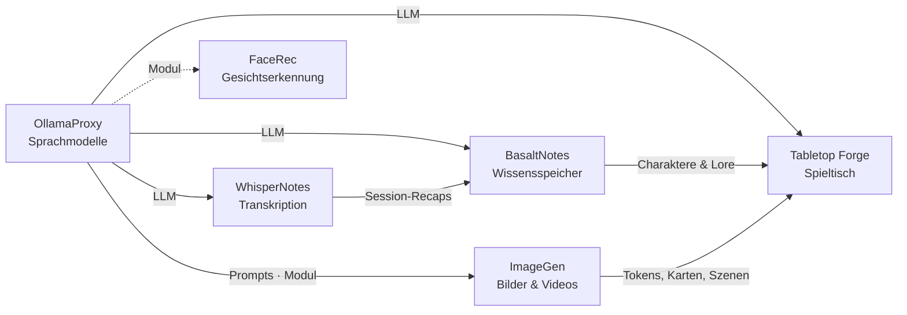

# BasaltNotes

🇬🇧 [English](README.md) · 🇩🇪 Deutsch

> Selbst gehostete Notiz-App nach dem Vorbild von Obsidian, mit einem KI-Kurator, der neue Inhalte selbst einsortiert –
> der Wissensspeicher der Poldion-Familie.

**Lizenz:** MIT · **Sprache:** TypeScript (Fastify, React, CodeMirror 6) · **Docker:** `poldion/basaltnotes` ·
**Teil von:** [Poldion Self-Hosted](#die-poldion-familie)


## Überblick

BasaltNotes verwaltet mehrere Vaults mit Markdown-Notizen, `[[Wiki-Links]]`, Backlinks, Eigenschaften und
Volltextsuche. **Die Dateien sind die Wahrheit:** Jeder Vault ist ein normaler Ordner mit Markdown-Dateien und git-Verlauf.
Du kannst ihn parallel in Obsidian öffnen.

Der optionale **KI-Kurator** sortiert neue Inhalte ein, z. B. Session-Recaps aus WhisperNotes. Er legt neue NPCs, Orte
und Quests an, ergänzt bestehende und lernt Schreibvarianten („Cydia“ → Zylia) als Alias. Nichts wird still
überschrieben. Jede Änderung ist ein git-Commit und lässt sich rückgängig machen.

## Funktionen

| Bereich | Was es kann |
|---|---|
| **Notizen** | Markdown + YAML-Frontmatter, stabile IDs, Typen mit Ordnern, Vorlagen und Eigenschaften – vom freien Notizbuch bis zum Alltag (Tagebuch, Aufgabe, Rezept …) |
| **Editor** | CodeMirror 6 mit Live-Vorschau, `[[`-Autovervollständigung inkl. Aliasse, Bilder einfügen, Autosave, Konflikterkennung |
| **Vaults** | Frei (nur Notizen, Ordner nach Wahl – wie Obsidian) oder mit Vorlage; Plugins bringen weitere Vorlagen mit |
| **Verknüpfung** | Backlinks mit Kontext, Umbenennen passt alle Links an, Graph-Ansicht, „Erwähnungen verknüpfen“ ohne KI |
| **Suche** | Volltext (SQLite FTS5), Filter nach Typ, Tag und Eigenschaft, Schnellöffner, Dataview-ähnliche Abfragen |
| **KI-Kurator** | Erkennen → Abgleichen → Planen → Anwenden oder Vorschlagen (mit Diff), Regeln je Vault, Trockenlauf, „Lauf rückgängig“ |
| **Fragen** | Chat mit den Notizen; passende Einträge werden ohne LLM vorausgewählt – gebaut für kleine lokale Modelle |
| **Dokumente** | PDF, Word, Text und Markdown in den Eingang hochladen; Text wird ausgelesen und einsortiert |
| **D&D** (Plugin) | Kampagnen mit Startseite und Timeline, Spieler-Sicht und Spieler-Konten, eigene Kurator-Regeln, Vorlage und Beispiel-Vault – mitgeliefert, nur bei Bedarf eingeschaltet |
| **Verlauf** | git-Commit pro Speichern, Diff und Wiederherstellen je Notiz, Papierkorb, ZIP-Export |
| **Plugins** | Erweiterungen mit Server- und Oberflächen-Teil; installieren und aktualisieren aus dem Katalog oder eigenen GitHub-Repos; Kalender & CalDAV (auch für Home Assistant) ist mitgeliefert |
| **Benutzer** | Admin oder Mitglied mit Rechte-Stufe je Vault, API-Tokens mit Freigaben je Vault |
| **Einbindung** | REST-API mit OpenAPI, Server-Sent Events, signierte Webhooks, iframe-Einbettungen, JS-SDK |
| **Oberfläche** | Deutsch und Englisch, Hell/Dunkel, bis Handybreite, als PWA installierbar, [Android-App](android/README.md) |

Der KI-Kurator und der Chat sind bei einer neuen Einrichtung **aus**. Ohne Sprachmodell ist BasaltNotes eine vollständige
Notiz-App.

## Schnellstart

```bash
docker compose up -d     # nutzt docker-compose.yml aus diesem Repository
```

Vorher in [docker-compose.yml](docker-compose.yml) den Pfad für die Vaults, `ADMIN_PASSWORD` und optional `LLM_URL`
anpassen. Danach `http://<host>:4400` öffnen und als `admin` anmelden. Ohne `ADMIN_PASSWORD` wird ein Passwort erzeugt
und einmal im Log ausgegeben. Eine Anleitung für **TrueNAS SCALE** steht im [Handbuch](docs/handbuch.md#installation-auf-truenas-scale).
Beim ersten Anmelden lassen sich die KI-Funktionen einschalten und ein Beispiel-Vault anlegen.

Die Sprache der Oberfläche richtet sich nach dem Browser; umschalten mit dem Knopf **DE/EN** unten in der Seitenleiste.

## Konfiguration

| Variable | Standard | Bedeutung |
|---|---|---|
| `ADMIN_PASSWORD` / `ADMIN_USER` | – / `admin` | Erstes Konto (nur beim ersten Start) |
| `LLM_URL` / `LLM_MODEL` | `http://localhost:11434` / – | Ollama bzw. OllamaProxy für Kurator und Chat; Modell leer = gerade geladenes Modell |
| `FEATURE_CURATOR` / `FEATURE_CHAT` | `false` | KI-Funktionen beim ersten Start einschalten |
| `AUTH_HEADER` | – | Anmeldung über Reverse-Proxy (Authelia/Authentik) |
| `CORS_ORIGINS` / `EMBED_ORIGINS` | – | Andere Apps, die per Browser zugreifen oder einbetten dürfen |
| `PUID` / `PGID` | `568` / `568` | Benutzer, dem die Dateien gehören |

Fehlermeldungen der API sind standardmäßig deutsch; mit `X-Basalt-Lang: en` oder `Accept-Language: en` kommen sie
auf Englisch. Der Fehler-`code` ist in jeder Sprache gleich.

Alle Einstellungen: [Handbuch → Konfiguration](docs/handbuch.md#konfiguration).

## Zusammenspiel mit der Poldion-Familie

- **[WhisperNotes](https://github.com/Poldion/WhisperNotes)** schickt Session-Recaps in den Eingang
  (`POST /api/v1/vaults/{vault}/inbox`), der Kurator sortiert sie ein. Umgekehrt liefert BasaltNotes das Glossar der
  Welt (`/names`), damit WhisperNotes Namen richtig schreibt.
- **[Tabletop Forge](https://github.com/Poldion/TabletopForge)** übernimmt Charaktere, Hintergründe und Bilder aus einem
  Vault je Kampagne. Bearbeitet wird weiter in BasaltNotes.
- **[OllamaProxy](https://github.com/Poldion/OllamaProxy)** liefert das Sprachmodell für Kurator und Chat; BasaltNotes
  liest dort die tatsächliche Kontextgröße aus.
- **Home Assistant** liest Kalender und To-do-Listen per CalDAV und legt Notizen per Sprache an.

## Die Poldion-Familie

Sechs selbst gehostete Projekte, die einzeln funktionieren und zusammen ein Ganzes ergeben:



| Projekt | Rolle |
|---|---|
| [OllamaProxy](https://github.com/Poldion/OllamaProxy) | KI-Zentrale: Sprachmodelle mit festen Einstellungen, Module für weitere Dienste |
| [ImageGen](https://github.com/Poldion/ImageGen) | Bilder und Videos mit ComfyUI, Web-App und API |
| [FaceRec](https://github.com/Poldion/FaceRec) | Gesichtserkennung an der Türklingel für Home Assistant |
| [WhisperNotes](https://github.com/Poldion/WhisperNotes) | Transkription, Sprechererkennung, Zusammenfassungen und D&D-Recaps |
| **BasaltNotes** (dieses Repository) | Notizen und Welt-Wiki mit KI-Kurator |
| [Tabletop Forge](https://github.com/Poldion/TabletopForge) | Digitaler Spieltisch und Kampagnenverwaltung für 5e |

## Dokumentation

- [docs/handbuch.md](docs/handbuch.md) – Installation, Konfiguration, Rollen, Kurator, Chat, Plugins, Home Assistant,
  vollständige API-Referenz mit Beispielen (Englisch: [manual.md](docs/manual.md))
- [docs/plan-blueprints.md](docs/plan-blueprints.md) – Plan: freie Vaults (umgesetzt) und Blueprints (geplant)
- [docs/anforderungen.md](docs/anforderungen.md) – ursprüngliche Anforderungen, historisch
- [CHANGELOG.md](CHANGELOG.md) – Versionsverlauf (nur Englisch)
- [CONTRIBUTING.md](CONTRIBUTING.md) – Entwicklungsumgebung, Tests, Regeln, Übersetzungen, Plugins schreiben (nur Englisch, mit deutschem Abschnitt)
- [SECURITY.md](SECURITY.md) – Sicherheitslücken melden (nur Englisch)

## Entwicklung

Voraussetzungen: Node.js ≥ 22.13 (empfohlen 24), git.

```bash
npm install
npm run dev            # API auf :8080 (DATA_DIR=./data)
npm run dev:web        # Oberfläche auf :5173 mit Proxy auf die API
npm test               # Server-Tests (inkl. Golden-Tests für den Kurator)
npm run build          # Server, Oberfläche, SDK und mitgelieferte Plugins bauen
npm run i18n:check     # fehlende oder fehlerhafte Übersetzungen
```

Aufbau: `server/` (Fastify, SQLite über `node:sqlite`), `web/` (React, CodeMirror 6, Vite), `packages/client/` (SDK),
`packages/plugin-sdk/`, `plugins/` (mitgelieferte Plugins).

## Lizenz & Drittanbieter

Der Code steht unter der [MIT-Lizenz](LICENSE). BasaltNotes bringt keine eigenen Modelle oder Daten mit; das Sprachmodell,
das du über Ollama anbindest, behält seine eigene Lizenz. Verwendete Software mit ihren Lizenzen:
[THIRD_PARTY_NOTICES.md](THIRD_PARTY_NOTICES.md). „Obsidian“ ist eine Marke von Dynalist Inc., „Dungeons & Dragons“ eine
Marke von Wizards of the Coast; BasaltNotes ist ein unabhängiges Projekt und mit keinem davon verbunden.

## Unterstützen

Wenn dir das Projekt hilft, freue ich mich über Rückmeldungen, Fehlerberichte und Pull Requests – siehe
[CONTRIBUTING.md](CONTRIBUTING.md).
Du kannst mir auch [einen Kaffee ausgeben](https://buymeacoffee.com/poldion).
