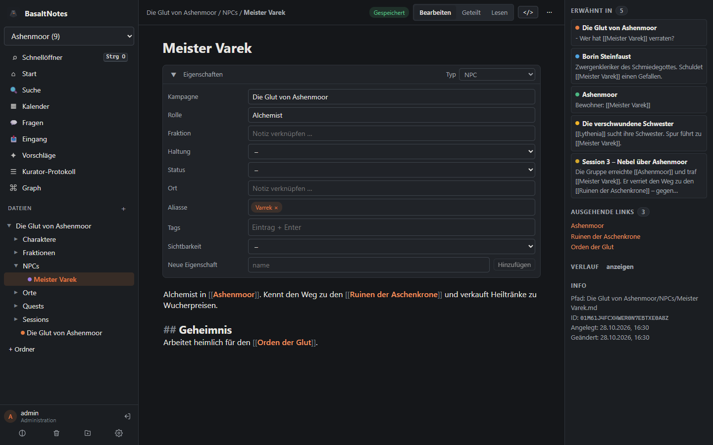
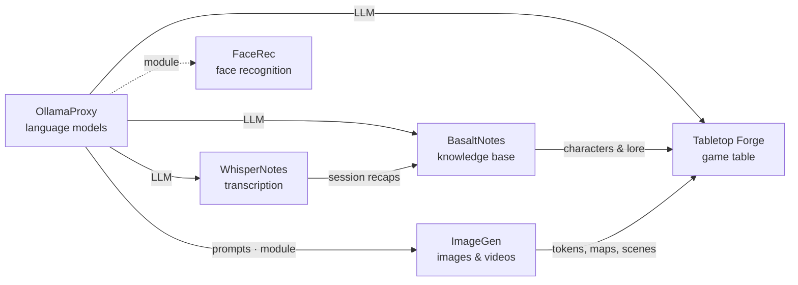

# BasaltNotes

🇬🇧 English · 🇩🇪 [Deutsch](README.de.md)

> A self-hosted note-taking app in the spirit of Obsidian, with an optional AI curator that files new content for you –
> the knowledge base of the Poldion family.

**License:** MIT · **Language:** TypeScript (Fastify, React, CodeMirror 6) · **Docker:** `poldion/basaltnotes` ·
**Part of:** [Poldion Self-Hosted](#the-poldion-family)



## Overview

BasaltNotes manages several vaults of Markdown notes with `[[wiki links]]`, backlinks, properties and full-text search.
**The files are the source of truth:** every vault is a plain folder of Markdown files with git history. You can open it
in Obsidian at the same time.

The optional **AI curator** files new content, e.g. session recaps from WhisperNotes. It creates new NPCs, places and
quests, extends existing notes and learns spelling variants (“Cydia” → Zylia) as aliases. Nothing is overwritten silently.
Every change is a git commit and can be undone.

## Features

| Area | What it does |
|---|---|
| **Notes** | Markdown + YAML frontmatter, stable IDs, types with folders, templates and properties – for D&D (campaign, session, NPC, location, quest …) and everyday life (journal, task, recipe …), plus your own types |
| **Editor** | CodeMirror 6 with live preview, `[[` autocomplete incl. aliases, image paste, autosave, conflict detection |
| **Vaults** | Free (just notes, folders as you like – like Obsidian) or with a template for D&D or everyday life; an example vault with a fictional campaign to try things out |
| **Linking** | Backlinks with context, renaming updates all links, graph view, “link mentions” without AI |
| **Search** | Full text (SQLite FTS5), filters by type, campaign, tag and property, quick switcher, Dataview-like queries |
| **AI curator** | Recognise → match → plan → apply or propose (with diff), rules per vault, dry run, “undo run” |
| **Ask** | Chat with your notes; matching entries are pre-selected without the LLM – built for small local models |
| **Documents** | Upload PDF, Word, text and Markdown to the inbox; the text is extracted and filed |
| **Campaigns** | Home page with “previously on”, timeline, open quests, characters, player view |
| **History** | git commit per save, diff and restore per note, trash, ZIP export |
| **Plugins** | Extensions with a server and a UI part; Calendar & CalDAV (also for Home Assistant) ships built in |
| **Users** | Roles (admin, edit, read, player), vault access per account, API tokens with per-vault permissions |
| **Integration** | REST API with OpenAPI, server-sent events, signed webhooks, iframe embeds, JS SDK |
| **Interface** | English and German, light/dark, works down to phone width, installable as a PWA |

The AI curator and the chat are **off** on a fresh install. Without a language model BasaltNotes is a complete note app.

## Quick start

```bash
docker compose up -d     # uses docker-compose.yml from this repository
```

Before that, adjust the vault path, `ADMIN_PASSWORD` and optionally `LLM_URL` in [docker-compose.yml](docker-compose.yml).
Then open `http://<host>:4400` and sign in as `admin`. Without `ADMIN_PASSWORD` a password is generated and printed once in
the log. A guide for **TrueNAS SCALE** is in the [manual](docs/manual.md#installation-on-truenas-scale).
The first sign-in offers to switch on the AI features and to create an example vault.

The interface language follows your browser; switch it with the **EN/DE** button at the bottom of the sidebar.

## Configuration

| Variable | Default | Meaning |
|---|---|---|
| `ADMIN_PASSWORD` / `ADMIN_USER` | – / `admin` | First account (first start only) |
| `LLM_URL` / `LLM_MODEL` | `http://localhost:11434` / – | Ollama (or OllamaProxy) for curator and chat; empty model = the currently loaded one |
| `FEATURE_CURATOR` / `FEATURE_CHAT` | `false` | Switch the AI features on at first start |
| `AUTH_HEADER` | – | Sign-in via a reverse proxy (Authelia/Authentik) |
| `CORS_ORIGINS` / `EMBED_ORIGINS` | – | Other apps that may access BasaltNotes from the browser or embed it |
| `PUID` / `PGID` | `568` / `568` | User that owns the files |

API error messages are German by default; clients get English ones with `X-Basalt-Lang: en` or
`Accept-Language: en`. The error `code` is the same in every language.

All settings: [manual → configuration](docs/manual.md#configuration).

## Working with the Poldion family

- **[WhisperNotes](https://github.com/Poldion/WhisperNotes)** sends session recaps to the inbox
  (`POST /api/v1/vaults/{vault}/inbox`), the curator files them. In return BasaltNotes provides the world's glossary
  (`/names`) so that WhisperNotes spells names correctly.
- **[Tabletop Forge](https://github.com/Poldion/TabletopForge)** takes characters, backgrounds and pictures from one vault
  per campaign. Editing stays in BasaltNotes.
- **[OllamaProxy](https://github.com/Poldion/OllamaProxy)** provides the language model for curator and chat; BasaltNotes
  reads the actual context size from it.
- **Home Assistant** reads calendars and to-do lists via CalDAV and creates notes by voice.

## The Poldion family

Six self-hosted projects that work on their own and form a whole together:



| Project | Role |
|---|---|
| [OllamaProxy](https://github.com/Poldion/OllamaProxy) | AI hub: language models with fixed settings, modules for other services |
| [ImageGen](https://github.com/Poldion/ImageGen) | Images and videos with ComfyUI, web app and API |
| [FaceRec](https://github.com/Poldion/FaceRec) | Face recognition at the doorbell for Home Assistant |
| [WhisperNotes](https://github.com/Poldion/WhisperNotes) | Transcription, speaker detection, summaries and D&D recaps |
| **BasaltNotes** (this repository) | Notes and world wiki with an AI curator |
| [Tabletop Forge](https://github.com/Poldion/TabletopForge) | Digital game table and campaign management for 5e |

## Documentation

- [docs/manual.md](docs/manual.md) – installation, configuration, roles, curator, chat, plugins, Home Assistant, complete
  API reference with examples (German: [handbuch.md](docs/handbuch.md))
- [docs/plan-blueprints.md](docs/plan-blueprints.md) – plan: free vaults (done) and blueprints (planned) (German)
- [docs/anforderungen.md](docs/anforderungen.md) – original requirements, historical (German)
- [CHANGELOG.md](CHANGELOG.md) – version history
- [CONTRIBUTING.md](CONTRIBUTING.md) – development setup, tests, guidelines, translations, writing plugins
- [SECURITY.md](SECURITY.md) – reporting security issues

## Development

Requirements: Node.js ≥ 22.13 (24 recommended), git.

```bash
npm install
npm run dev            # API on :8080 (DATA_DIR=./data)
npm run dev:web        # UI on :5173 with a proxy to the API
npm test               # server tests (incl. golden tests for the curator)
npm run build          # build server, UI, SDK and built-in plugins
npm run i18n:check     # missing or broken translations
```

Layout: `server/` (Fastify, SQLite via `node:sqlite`), `web/` (React, CodeMirror 6, Vite), `packages/client/` (SDK),
`packages/plugin-sdk/`, `plugins/` (built-in plugins).

## License & third parties

The code is licensed under the [MIT license](LICENSE). BasaltNotes ships no models or data of its own; the language model
you connect via Ollama keeps its own license. Software used and its licenses: [THIRD_PARTY_NOTICES.md](THIRD_PARTY_NOTICES.md).
“Obsidian” is a trademark of Dynalist Inc., “Dungeons & Dragons” a trademark of Wizards of the Coast; BasaltNotes is an
independent project and not affiliated with either.

## Support

If the project helps you, I'm happy about feedback, bug reports and pull requests – see [CONTRIBUTING.md](CONTRIBUTING.md).
You can also [buy me a coffee](https://buymeacoffee.com/poldion).
